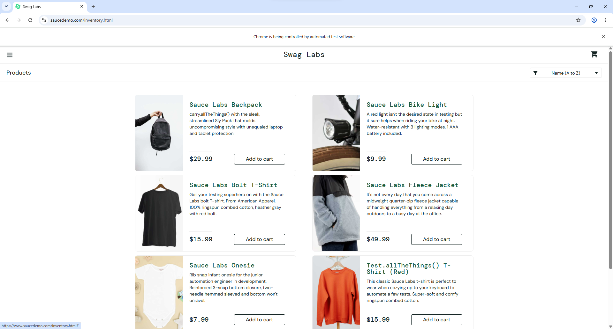
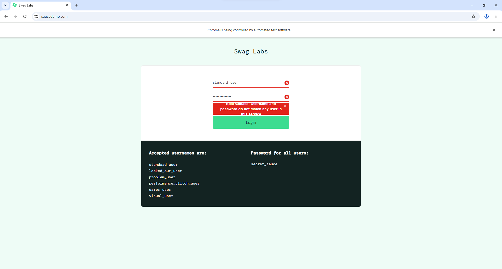
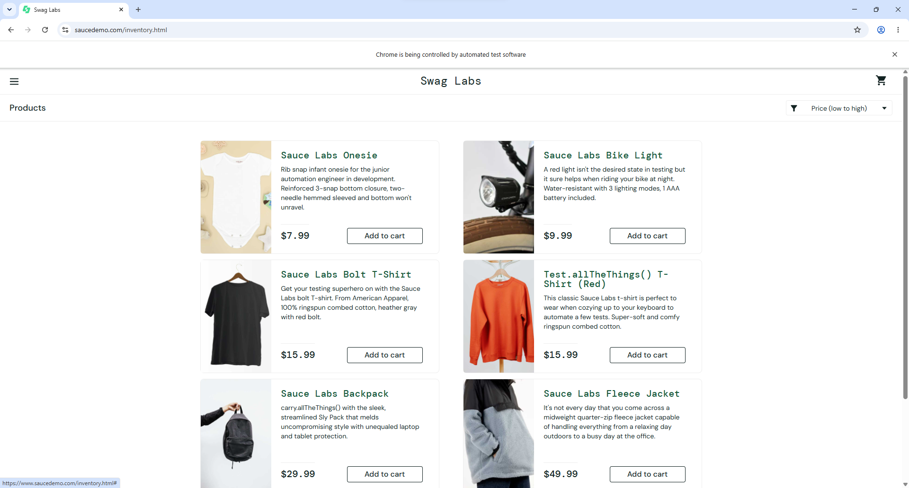
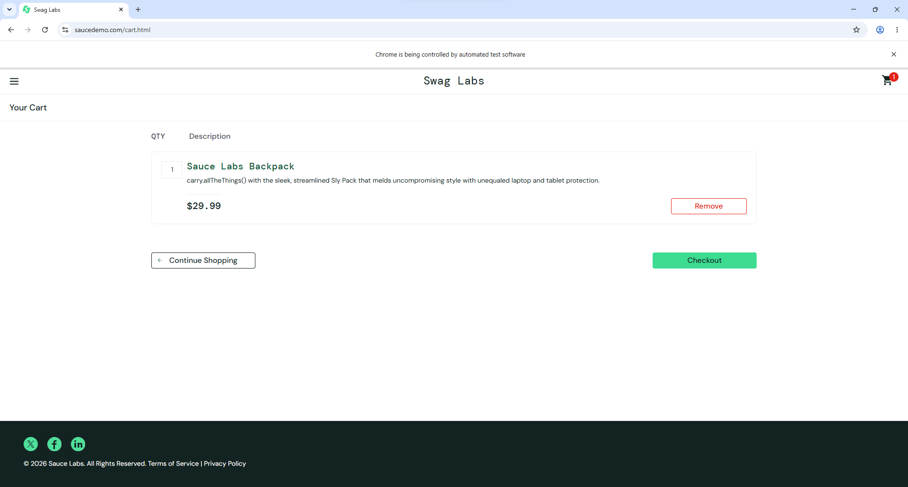
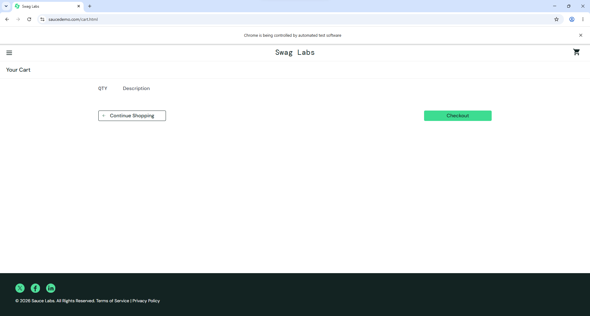
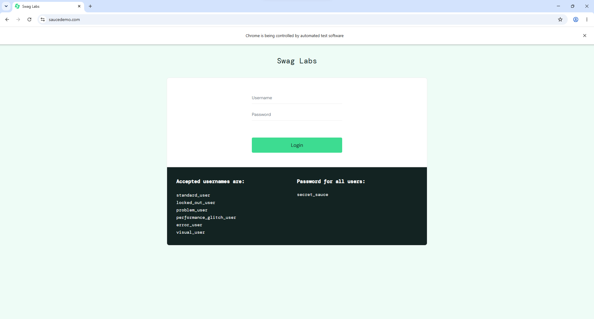

# BÁO CÁO KIỂM THỬ TỰ ĐỘNG WEBSITE BẰNG SELENIUM

## 1. Giới thiệu đề tài

**Đề tài:** Xây dựng các test case kiểm thử tự động cho website thương mại điện tử bằng Selenium WebDriver.

- **Website kiểm thử:** [SauceDemo](https://www.saucedemo.com/)
- **Ngôn ngữ lập trình:** Python
- **Công cụ:** Selenium WebDriver, pytest, pytest-html và Google Chrome
- **Môi trường thực hành:** Windows 11, Python 3.13.2, pytest 9.1.1
- **Mã nguồn:** [GitHub – Testing_-Selenium](https://github.com/silentn9990/Testing_-Selenium)

**Mục tiêu:** Tìm hiểu cách tự động thao tác trên giao diện website, kiểm tra kết quả bằng các câu lệnh `assert`, xây dựng tối thiểu 05 test case và ghi nhận bằng chứng kiểm thử. Dự án thực hiện **06 test case**.

## 2. Công cụ và phương pháp thực hiện

- **Selenium WebDriver:** Tự động mở và điều khiển trình duyệt Chrome để nhập dữ liệu, nhấn nút, điều hướng trang và đọc trạng thái giao diện.
- **pytest:** Quản lý test case, sử dụng fixture khởi tạo/đóng trình duyệt, chạy kiểm thử và tổng hợp kết quả.
- **WebDriverWait:** Chờ các thành phần trên trang xuất hiện hoặc thay đổi trước khi xác minh kết quả.
- **Screenshot:** Lưu ảnh minh họa tại các trạng thái thực tế của website sau khi thao tác.

Mỗi test case được tổ chức trong `tests/test_saucedemo.py`. Cấu hình trình duyệt và cơ chế chụp ảnh nằm trong `tests/conftest.py`.

## 3. Cấu trúc dự án

```text
Testing_-Selenium/
├── images/
│   ├── TC01_Login_Success.png
│   ├── TC02_Login_Failed.png.png
│   ├── TC03_Sort_Price.png
│   ├── TC04_Add_To_Cart.png
│   ├── TC05_Remove_From_Cart.png
│   └── TC06_Logout.png
├── reports/                    # Kết quả tạo khi chạy trên máy
├── tests/
│   ├── conftest.py             # Fixture Chrome, screenshot
│   └── test_saucedemo.py       # 06 test case
├── .gitignore
├── pytest.ini
├── requirements.txt
└── README.md
```

> Thư mục `images/` chứa **chỉ 06 ảnh minh họa cho 06 test case**. Tên ảnh TC02 có hai đuôi `.png` đúng theo tên tệp đang được lưu trong repository.

## 4. Hướng dẫn cài đặt và chạy

**Yêu cầu:** Máy có Python, Google Chrome, Git và kết nối Internet.

Mở Terminal (PowerShell) trong VS Code rồi thực hiện:

```powershell
git clone https://github.com/silentn9990/Testing_-Selenium.git
cd Testing_-Selenium
python -m venv .venv
.\.venv\Scripts\python.exe -m pip install -r requirements.txt
```

Chạy toàn bộ test case:

```powershell
.\.venv\Scripts\python.exe -m pytest -v
```

Ví dụ chạy riêng TC01:

```powershell
.\.venv\Scripts\python.exe -m pytest tests/test_saucedemo.py::test_tc01_login_success -v
```

Nếu muốn giữ cửa sổ Chrome hiển thị trong 5 giây sau mỗi test (PowerShell):

```powershell
$env:BROWSER_HOLD_SECONDS="5"
.\.venv\Scripts\python.exe -m pytest -v
```

Đặt biến về `"0"` để chạy nhanh mà không chờ thêm.

## 5. Danh sách các test case

| ID | Tình huống kiểm thử | Các bước chính | Kết quả mong đợi |
|---|---|---|---|
| TC01 | Đăng nhập hợp lệ | Nhập tài khoản `standard_user`, mật khẩu `secret_sauce`, nhấn Login | Chuyển đến trang Products |
| TC02 | Đăng nhập sai mật khẩu | Nhập `standard_user`, mật khẩu sai, nhấn Login | Hiển thị thông báo lỗi đăng nhập |
| TC03 | Sắp xếp giá tăng dần | Đăng nhập, chọn `Price (low to high)` | Sản phẩm được sắp theo giá từ thấp đến cao |
| TC04 | Thêm sản phẩm vào giỏ | Đăng nhập, chọn Sauce Labs Backpack, thêm vào giỏ và mở giỏ hàng | Giỏ có Sauce Labs Backpack với số lượng 1 |
| TC05 | Xóa sản phẩm khỏi giỏ | Thêm Sauce Labs Backpack, mở giỏ và chọn Remove | Giỏ hàng không còn sản phẩm |
| TC06 | Đăng xuất | Đăng nhập, mở menu, chọn Logout | Quay lại màn hình Login |

## 6. Kết quả kiểm thử và ảnh minh họa

Trong **một lần chạy thực tế trên Windows 11**, pytest ghi nhận kết quả **6 passed, 0 failed trong 51,04 giây**. Đây là kết quả của lần chạy đó, không phải khẳng định mọi lần chạy đều thành công: ở một số lần chạy tiếp theo, các thao tác giao diện có xuất hiện lỗi chờ/điều hướng không ổn định.

| Test case | Kết quả của lần chạy 6/6 | Bằng chứng |
|---|---|---|
| TC01 – Đăng nhập đúng | PASSED | Ảnh 1 |
| TC02 – Đăng nhập sai | PASSED | Ảnh 2 |
| TC03 – Sắp xếp giá | PASSED | Ảnh 3 |
| TC04 – Thêm vào giỏ | PASSED | Ảnh 4 |
| TC05 – Xóa khỏi giỏ | PASSED | Ảnh 5 |
| TC06 – Đăng xuất | PASSED | Ảnh 6 |

### TC01 – Kiểm thử đăng nhập thành công

**Thao tác:** Nhập tên đăng nhập `standard_user` và mật khẩu `secret_sauce`, sau đó nhấn Login.

**Kết quả mong đợi:** Website chuyển đến trang sản phẩm (`inventory.html`).

**Ảnh minh họa:** Trang Products hiển thị danh sách sản phẩm sau khi đăng nhập.



### TC02 – Kiểm thử đăng nhập sai mật khẩu

**Thao tác:** Nhập tài khoản `standard_user` cùng mật khẩu không hợp lệ và nhấn Login.

**Kết quả mong đợi:** Website không cho đăng nhập, hiển thị thông báo thông tin đăng nhập không khớp.

**Ảnh minh họa:** Thông báo lỗi đăng nhập trên giao diện SauceDemo.



### TC03 – Kiểm thử sắp xếp sản phẩm theo giá tăng dần

**Thao tác:** Đăng nhập, chọn tùy chọn `Price (low to high)`.

**Kết quả mong đợi:** Danh sách giá được sắp từ thấp đến cao.

**Ảnh minh họa:** Các sản phẩm xuất hiện theo thứ tự giá tăng dần, bắt đầu từ 7.99 USD và 9.99 USD.



### TC04 – Kiểm thử thêm sản phẩm vào giỏ hàng

**Thao tác:** Đăng nhập, thêm `Sauce Labs Backpack` vào giỏ hàng rồi mở trang Your Cart.

**Kết quả mong đợi:** Giỏ có sản phẩm được chọn, số lượng `1`.

**Ảnh minh họa:** Sản phẩm Sauce Labs Backpack trong giỏ hàng.



### TC05 – Kiểm thử xóa sản phẩm khỏi giỏ hàng

**Thao tác:** Thêm `Sauce Labs Backpack` vào giỏ, mở giỏ và nhấn Remove.

**Kết quả mong đợi:** Giỏ hàng không còn sản phẩm và không hiển thị số lượng trên biểu tượng giỏ.

**Ảnh minh họa:** Trang Your Cart trống sau khi xóa sản phẩm.



### TC06 – Kiểm thử đăng xuất

**Thao tác:** Đăng nhập thành công, mở menu và nhấn Logout.

**Kết quả mong đợi:** Website quay về trang đăng nhập.

**Ảnh minh họa:** Màn hình Login xuất hiện sau khi đăng xuất.



## 7. Nhận xét và kết luận

- Đã xây dựng **06 test case Selenium tự động**, vượt yêu cầu tối thiểu 05 test case.
- Kiểm thử được các chức năng cơ bản: đăng nhập hợp lệ/không hợp lệ, sắp xếp, thêm và xóa sản phẩm khỏi giỏ, đăng xuất.
- Đã ghi nhận một lần thực thi đủ **6/6 PASSED** và lưu 06 ảnh minh họa tương ứng.
- Một số lần chạy sau có lỗi không ổn định do tương tác/chuyển trang chưa đáp ứng điều kiện chờ; đây là giới hạn cần tiếp tục cải thiện nếu mở rộng dự án.
- Selenium hỗ trợ tiết kiệm thao tác thủ công và tăng khả năng lặp lại quy trình kiểm thử; tuy nhiên vẫn cần đánh giá độ ổn định qua nhiều lần chạy.

## 8. Tài liệu tham khảo

- [Selenium WebDriver Documentation](https://www.selenium.dev/documentation/webdriver/)
- [Selenium Manager](https://www.selenium.dev/documentation/selenium_manager/)
- [pytest Documentation](https://docs.pytest.org/)
- [SauceDemo](https://www.saucedemo.com/)
